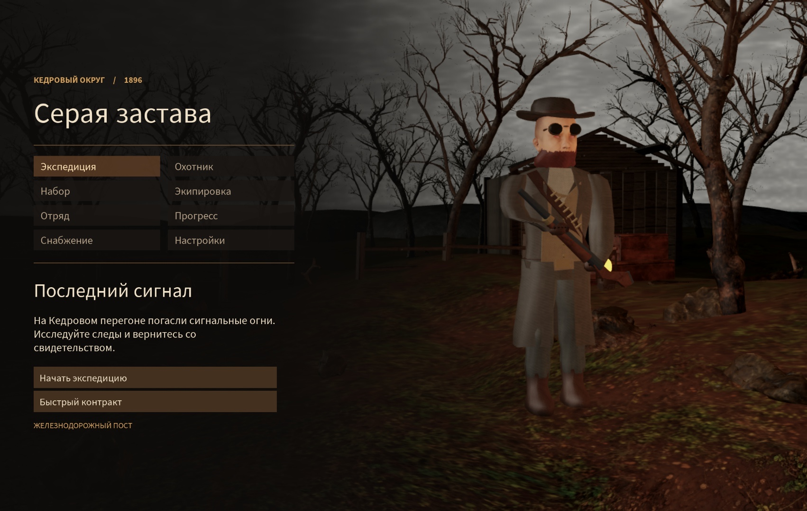

# Визуальный просмотр лобби

В первом кадре Studio края леса были слишком жёсткими, под тёмной шляпой терялось лицо, а при более раннем времени окно между стволами давало голубой просвет. В контрольном просмотре проверены более раннее время вечера, мягкая подсветка персонажа и облачный покров. Текстура тропы и ближние камни отобразились. Повторяемые развилки временных деревьев отмечены для замены ветвистыми сетками.

Заменены повторявшиеся прямые развилки. Стволы и кроны теперь собираются из двух частей сухого дерева с UV и запечёнными картами, с вариациями масштаба и поворота.

В первом Play проходе после импорта персонаж был развёрнут спиной по преобразованию системы координат GLB. Встроенная ткань давала крупные пятна на мешах без UV. Сборка компенсирует поворот импортёра. Лицо получило оригинальную UV-развёртку, пальто, брюки, платок и шляпа — нейтральную ткань с картой нормалей и шероховатости. Цвет пальто по-прежнему зависит от выбранного охотника.

Для итоговой сборки приглушены отражения на лице и одежде, добавлены дымчатые очки железнодорожника и расширены полы пальто у колен. Голова, перчатки и реквизит сохранены в пределах рассчитанного кадра.

| Проверено в итоговом кадре | Результат |
|---|---|
| Передний план | Тропа имеет неровный рельеф, карты грунта и камней различимы |
| Средний и дальний планы | Фонарь, груз и пост читаются отдельно от леса. Ветви и серое небо поддерживают силуэт |
| Охотник | Шляпа, кисти, реквизит и сапоги в кадре. Детали опираются на жёсткие группы. Складки движутся вместе с группой тела |
| Существующее меню | Панель занимает левую часть, фигура остаётся справа. Затемнение доходит до края экрана |

Кадр сделан в живом режиме Play. Материалы прошли проверку загрузки. Схема не подтверждает визуальную паритетность с Crytek. Перед релизом опубликованного опыта отдельно требуется проверить доступность приватных Roblox-ассетов под его владельцем.
